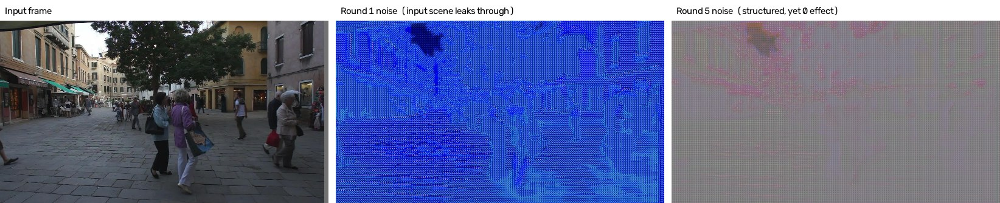

# Paradigm-Neutral Temporal Consistency Attack on MOT

> **Status: archived research prototype.** This project explored whether a
> generative, transferable adversarial attack could break multi-object tracking
> by targeting only what every tracker shares — backbone features and boxes —
> instead of a tracker-specific module. The experiments converged on a clear
> negative result (see **Key Finding**), and the work was wound down there.
> The code, diagnostics, and the reasoning that led to the finding are left here
> as a record.

An attempt to extend SCGA (ICLR 2026) — a generative, single-forward-pass
transfer attack for image classification — to multi-object tracking (MOT).
The idea was to disrupt **temporal consistency defined purely from detector
backbone features and box geometry**, quantities present in every detector,
so the attack would transfer across tracker paradigms rather than being bound
to one tracker's components.

---

## Motivation

Existing MOT attacks target components that exist only in specific trackers:

| Paper | Target | On ReID-free ByteTrack |
|---|---|---|
| BBA (Neural Networks 2024) | detection heatmap (blind / blur) | `blur` collapses MOTA 76.6 → −1252.6 by flooding false detections |
| TraSA (ASOC 2024) | re-ID branch + box center | succeeds via box-center term alone, but white-box, up to 60 iters/frame |
| BankTweak (IJCAI 2025) | ReID feature bank | not applicable |
| FADE (CVPR 2026) | MOTR track query | does not exist |

So the two proven routes against a ReID-free tracker are **(a) destroy
detection** or **(b) per-frame iterative optimization**. A single-forward,
transferable attack that targets *association* directly had not been proposed.
That was the gap this project aimed at.

The proposed attack uses **backbone features and box geometry only**:

```
d_k = [ L2norm(GAP(ROIAlign(F, b_k))) ; alpha * (cx, cy, w, h) ]   # object descriptor (260-d)

L_decorr  =  mean_k  cos( d_t[k],  d_{t+1}[k] )       # pull same object apart across frames
L_confuse = -mean_{k!=j} cos( d_t[k], d_{t+1}[j] )    # pull different objects together
```

Both losses are **centered** (shared mean removed) before the cosine. Without
centering, different objects already sit at cosine ≈ +0.80 and the loss cannot
drive learning. The attack references no Kalman filter, no Hungarian matching,
no ReID head, no track query — that is the sense in which it is "paradigm-neutral".
SCGA's generator and EMA-consistency structure are reused as-is; only the data
(frame pairs), surrogate (detector), and losses are swapped.

---

## Key Finding

After seven training/evaluation rounds, the result was negative — and the
*reason* is the interesting part:

> **The object descriptor and the detection head share the same backbone
> features, so their sensitivity directions do not separate.** Perturbations
> that preserve detection also leave the descriptor unchanged; perturbations
> that move the descriptor destroy detection. There is no middle ground.

Evidence (MOT17-02-FRCNN, val half, YOLOX-S, 800×1440; clean baseline
MOTA 54.9 / IDF1 52.7 / Recall 62.8):

| Round | Change | Result | Diagnosis |
|---|---|---|---|
| 1 | SCGA structure as-is | IDF1 52.7 → **60.9** (attack *helps* tracking) | 98% of pixels clipped at the eps box → ~2% of pixels receive gradient; the generator was reconstructing the input, not attacking |
| 2 | fix perturbation parameterization | loss drops, but **Recall 62.8 → 5.5** | attack destroys the detector, not association |
| 3 | add detection-preservation constraint `L_keep` | attack vanishes (loss 0.92 → 0.91) | — |
| 4 | sweep constraint weight 0 → 3.0 | no middle ground; 30× weight change leaves loss identical to 3 decimals | not a tuning problem |
| 5 | block the "do-nothing" trivial solution (global color shift) | structured, screen-locked perturbation using 44% of the budget on spatial structure — yet **detections 371.02 → 370.96** and same-ID descriptor change **+0.0000** | the two objectives are coupled through the shared backbone |



*Left:* a clean MOT17 frame. *Middle (Round 1):* the learned perturbation is a
faint copy of the input scene — the generator was reconstructing, not attacking.
*Right (Round 5):* after fixing that and blocking the trivial solutions, the
perturbation finally carries genuine spatial structure (no tone bias, 44% of the
budget on structure) — yet detections and the descriptor are both unchanged.
The attack is real; the two objectives simply do not separate.

This also explains the related work: BBA, TraSA, BankTweak, and FADE all target
modules that are **separate from the detector** (ReID heads, track queries) —
precisely because that is where a separable direction exists.

**Scope.** This is not a proof that no such direction exists — only that gradient
descent did not find one under this descriptor design (`GAP(ROIAlign(F, level 1))`),
this detector (YOLOX-S), and this sequence. TraSA does change ByteTrack IDs via
per-frame iterative optimization; what was not found here is a *single-forward,
global* perturbation.

The full experiment log and diagnostic reasoning are documented alongside the
code (kept locally, not committed).

---

## Repository layout

```
mot-scga-attack/
├── yolox/ tools/ exps/     ByteTrack originals (unmodified)
├── generator/              SCGA originals (unmodified)
├── reference/              SCGA training script (reference only)
└── attack/                 ★ this work
    ├── dataset.py            MOT17 frame pairs + boxes + IDs
    ├── descriptor.py         object descriptor
    ├── losses.py             L_decorr, L_confuse, L_iou, L_keep + SCGA utils
    ├── generator_wrap.py     per-block feature extraction from the generator
    ├── compat.py             numpy 2.x compatibility shims
    ├── train_generator.py    training
    ├── evaluate.py           attack evaluation (MOTA/IDF1/IDSW)
    ├── diagnose.py           failure-cause diagnostics (noise / detection dist / descriptor)
    ├── smoke_test.py         unit tests
    ├── e2e_test.py           end-to-end single-step check
    └── viz_dataset.py        dataloader visual check
```

**ByteTrack and SCGA originals are never modified.** Even the numpy
compatibility issue is handled in `attack/compat.py` rather than in the
upstream code, so results cannot be confounded by edits to the baselines.

---

## Setup

```bash
conda create -n mot python=3.12 -y
conda activate mot

# PyTorch — pick the build matching your GPU architecture
pip install torch torchvision --index-url https://download.pytorch.org/whl/cu128

pip install opencv-python-headless motmetrics lap cython_bbox \
            loguru thop tabulate pycocotools gdown kagglehub tqdm
```

`cython_bbox` needs a compiler and Python headers:

```bash
sudo apt-get install -y build-essential python3-dev
```

Verify the GPU (the device `capability` must be in the build's `arch list`):

```bash
python -c "import torch; print(torch.__version__, torch.cuda.is_available(), \
torch.cuda.get_device_capability(0), torch.cuda.get_arch_list())"
```

---

## Data and weights

**MOT17** — kept outside the repo, linked via a symlink:

```bash
pip install kagglehub
python -c "import kagglehub; print(kagglehub.dataset_download('wenhoujinjust/mot-17'))"
ln -sfn <path above>/MOT17 datasets/mot
```

Expected layout:

```
datasets/mot/train/MOT17-02-FRCNN/
├── img1/000001.jpg ...
├── gt/gt.txt        frame,id,x,y,w,h,conf,class,visibility
└── seqinfo.ini
```

**Detector weights** — from the ByteTrack model zoo:

```bash
mkdir -p pretrained
gdown 1uSmhXzyV1Zvb4TJJCzpsZOIcw7CCJLxj -O pretrained/bytetrack_s_mot17.pth.tar  # YOLOX-S
gdown 1P4mY0Yyd3PPTybgZkjMYhFri88nTmJX5 -O pretrained/bytetrack_x_mot17.pth.tar  # YOLOX-X
```

---

## Quick check

All commands run from the repo root with `PYTHONPATH=.`.

```bash
PYTHONPATH=. python attack/smoke_test.py       # unit tests (no GPU)
PYTHONPATH=. python attack/viz_dataset.py --n 3 # dataloader check -> output/viz/pair_*.jpg
PYTHONPATH=. python attack/e2e_test.py          # end-to-end single step
```

---

## Training

```bash
PYTHONPATH=. python attack/train_generator.py \
    --data_root datasets/mot \
    --exp_file exps/example/mot/yolox_s_mix_det.py \
    --ckpt pretrained/bytetrack_s_mot17.pth.tar \
    --batch_size 4 --epochs 3 --w_iou 1.0
```

Main arguments:

| Arg | Default | Meaning |
|---|---|---|
| `--eps` | 10 | L-inf budget (x/255) |
| `--delta_param` | `additive` | perturbation parameterization (see below) |
| `--w_iou` | 0.0 | weight of `L_iou`; 0 disables it |
| `--w_keep` | 1.0 | weight of `L_keep` (holds detection at the clean state) |
| `--zero_dc` | off | remove the constant (global tone) component of the perturbation |
| `--alpha` | 1.0 | weight of the geometry part of the descriptor |
| `--lam` | 1.0 | weight of `L_confuse` |
| `--fpn_level` | 1 | backbone level (0=stride8, 1=stride16, 2=stride32) |
| `--iou_thr` | 0.1 | min IoU for prediction↔GT matching |
| `--roi_source` | pred | take ROI from predicted boxes or GT |
| `--no_center` | off | disable descriptor centering (ablation) |
| `--w_consistency` | 0.7 | SCGA consistency-loss weight |

Output goes to `experiments/<time>_<method>_<generator>/`. The **teacher (EMA)**
is saved, not the student. For long runs, launch with `nohup` and read
`logs/train.log`; the same values accumulate in `loss_log.csv` for plotting.

### `--delta_param` — why the first attempt learned nothing

The SCGA/BIA original (`image`) has the generator emit a full `tanh` image, then
clips it into the eps box. To fit inside the box the generator must first learn
near-identity reconstruction — feasible with ImageNet×10 epochs, not with ~2k
MOT17 steps.

Measured (Round 1): **98% of pixels sat at the eps boundary.** `clamp` sends
exactly zero gradient to clipped pixels, so only ~2% of pixels trained — which
is why the noise map looked like a copy of the input scene.

```
image      adv = clamp(G(x), x-eps, x+eps)      dead-gradient pixels 98.7%
additive   adv = clamp(x + eps*G(x), 0, 1)      dead-gradient pixels  0.0%
```

Since `G`'s output is already `tanh` in `[-1,1]`, multiplying by `eps` lands
exactly inside the budget. Both modes are kept as an ablation; the numbers
reproduce in `attack/smoke_test.py [5b]`. **Evaluation and diagnosis must use
the same value as training**, or the attack is not well-defined.

### `L_iou` (`--w_iou`)

256 of the descriptor's 260 dimensions are appearance, but **ByteTrack never
uses appearance** (BYTE stage-1 cost = `1 - IoU*score`, stage-2 = `1 - IoU`),
so a perfect appearance attack leaves its IDF1 untouched.

```
L_iou = mean_k IoU( b_t[k], b_{t+1}[k] )     # push the same object's box apart across frames
```

Boxes exist in every tracker, so paradigm-neutrality is preserved.

### `L_keep` (`--w_keep`) — without it, detection always collapses

The descriptor's appearance part is `GAP(ROIAlign(F, b))`, and **the detection
head reads the same `F`**:

```
F = backbone(x)
 ├→ head(F)              → boxes, scores   (detection)
 └→ GAP(ROIAlign(F, b))  → descriptor      (attack target)
```

So the cheapest way to lower `L_decorr` is to wreck `F`, which also kills
detection — the optimizer takes that shortcut every time:

| Measured | Precision | Recall | Outcome |
|---|---|---|---|
| clean | 89.7 | 62.8 | — |
| Round 2 (`w_iou 1.0`, `w_keep 0`) | 42.1 | **5.5** | detection suppressed |
| Round 2b (`w_iou 0`, `w_keep 0`) | **0.1** | 5.9 | false-positive flood (1,873 tracks/frame) |

Disabling `w_iou` changed nothing, so the cause is not a loss term but the
**absence of a separation mechanism**:

```
L_keep = mean_{s_clean >  tau} | s_adv - s_clean |     visible detections: two-sided
       + mean_{s_clean <= tau} relu( s_adv - tau )     background: only if it rises past tau
       + mean_k ( 1 - IoU(b_adv_k, gt_k) )             pin matched boxes to GT
```

Making the background term **one-sided** matters: constraining all ~23,600
anchors two-sided preserved detection perfectly (`dscore` 0.0008) but froze
`L_decorr` entirely — effectively "don't touch the backbone". ByteTrack cannot
see below `tau`(=0.1), so background scores need not be pinned. `--w_keep 0`
reproduces the collapse above.

---

## Evaluation

Clean and attacked runs use one script; `--attack_ckpt` is the only switch.

```bash
PYTHONPATH=. python attack/evaluate.py --seqs MOT17-02-FRCNN --tag clean
PYTHONPATH=. python attack/evaluate.py --seqs MOT17-02-FRCNN \
    --attack_ckpt experiments/<dir>/teacher_ptca_final.pth --tag attack
```

Training uses `--half first`, so evaluation defaults to `--half second` (no overlap).

| Metric | Meaning | Note |
|---|---|---|
| MOTA | overall detection | drops from false positives alone |
| **IDF1** | **ID consistency** | ★ this must drop to call tracking "broken" |
| IDSW | ID switches | 0 can also mean no tracks exist |

---

## Diagnostics

When a metric comes out unexpected, narrow the cause before retraining. The
same frame is run through clean and attacked paths, measuring four things at once:

```bash
PYTHONPATH=. python attack/diagnose.py \
    --attack_ckpt experiments/<dir>/teacher_ptca_final.pth
```

| Item | What it distinguishes |
|---|---|
| noise stats | residual std vs eps — a near-constant delta means a global tone shift, not an attack |
| image dump | clean / attacked / amplified-δ written to `output/diagnose/<dir>/` |
| detection distribution | BYTE stage-1 (≥`track_thresh`) vs stage-2 (0.1~thr) counts |
| descriptor cosine | unchanged same-ID cosine on the eval half = no generalization; dropped but IDF1 intact = loss-effect mismatch |

A verdict line is printed at the end. Descriptor/attack arguments must match
those used in training.

---

## Upstream repositories

| Purpose | Location |
|---|---|
| ByteTrack | https://github.com/FoundationVision/ByteTrack |
| SCGA | https://github.com/andyj1/SCGA |
| ByteTrack attack (reference implementation) | https://github.com/DerryHub/ByteTrack-attack |
| Evaluation toolkit | https://github.com/JonathonLuiten/TrackEval |

The original ByteTrack README is kept as [README_ByteTrack.md](README_ByteTrack.md).
